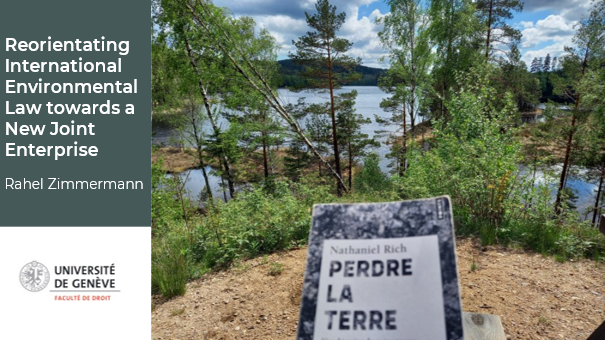
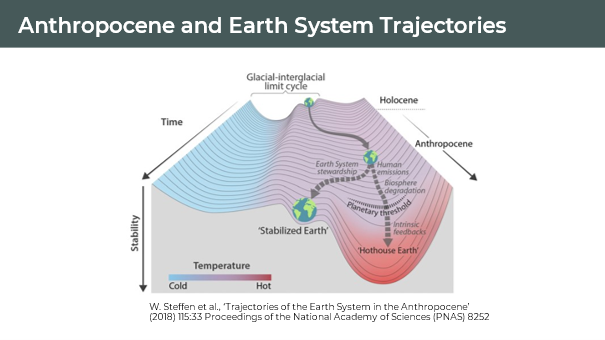
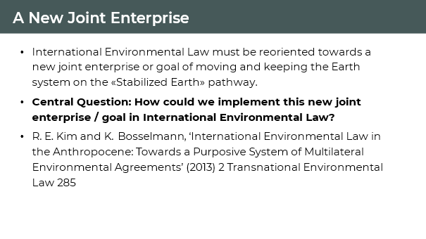

It was a great honour and pleasure to present my current research at the [20th IUCN Academy of Environmental Law Colloquium](https://sites.uef.fi/iucn-ael-2023/). In my presentation, I argued for the introduction of an overaching goal or joint enterprise for international environmental law (IEL), towards which all international and national actors have to work.

This idea of an overarching goal for IEL is not a new one. Kim and Bosselmann proposed already in 2013 the introduction of a single, legally binding, and superior «grundnorm» that would provide all international regimes and organizations a shared purpose to which their specific objectives must contribute. My approach, however, differs in that it grounds this overarching goal in Earth system science, specifically in the concept of Earth System trajectories.

Here you can see the **«Earth System trajectories»**. Humans have always lived in the very stable Holocene epoch. Since the turn of the century, however, more and more scientists argue that we have entered a new geological epoch. This new epoch is called the Anthropocene because mankind now is the major environmental force and threatens the planetary stability that we are so used to.

As you can see in the figure, earth has already left the relative warmth of the Holocene to its present position in the hotter Anthropocene, where we find ourselves now at a crossroads with two divergent pathways of the Earth system: 

On our current trajectory, the Earth system is on a **«Hothouse Earth» pathway** driven by human emissions of greenhouse gases and biosphere degradation towards the planetary threshold at around 2 °C. Beyond this threshold the Earth system would follow an irreversible pathway outside of human influence or control.

The other pathway leads to a **«Stabilized Earth»**, warmer and different from anything our species has ever known, but certainly more manageable than a Hothouse Earth. Here, humanity must play an active role as planetary steward by managing on an ongoing basis its relationship with the rest of the Earth system. 

So, the science is clear: If the planetary threshold is crossed toward the «Hothouse Earth» pathway, this would pose severe risks for health, economics, political stability and, ultimately, the habitability of the planet for humans. **As a consequence, humanity’s common goal needs to be to move the Earth system onto the «Stabilized Earth» pathway.**

**On that ground, I argue that, to remain relevant in the future, IEL must ensure that humanity steers towards this path. In order to achieve this monumental task, we must reform and reorientate IEL towards this overarching objective, so that all relevant actors work together in a new joint enterprise.**

In the remainder of my presentation, I discussed different avenues through which such an overarching goal could be introduced into IEL, as well as criteria for evaluating these avenues in order to identify the most viable and effective reform approach.
