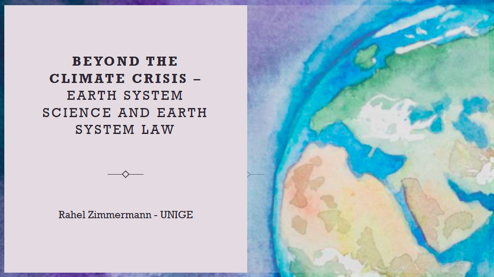

Today I could present parts of my research at the séminaire doctoral «la crise climatique au prisme de la recherche doctorale en droit» at the University of Lausanne. In my presentation, I introduced fellow doctoral researchers to Earth System Science and Earth System Law. 

The latter is a relatively new legal imaginary that was first proposed in 2019 and is inspired by insights from Earth System Science, including the Anthropocene and the planetary boundaries. The proponents of ESL argue that our current legal systems, particularly international environmental law (IEL), are not apt to respond to the global changes we face today in the Anthropocene. For instance, IEL is highly fragmented and sectoral as we have for each environmental problem a seperate treaty regime. It is also stronlgy state-centric, relying primarily on states as central source of legitimacy and authority. Moreover, IEL generally does not foresee big behavioral changes in societies and lacks the necessary normative ambition. 

In my doctoral thesis, I examine these deficiencies of IEL in greater detail and explore ways of how ESL could be translated into practice.