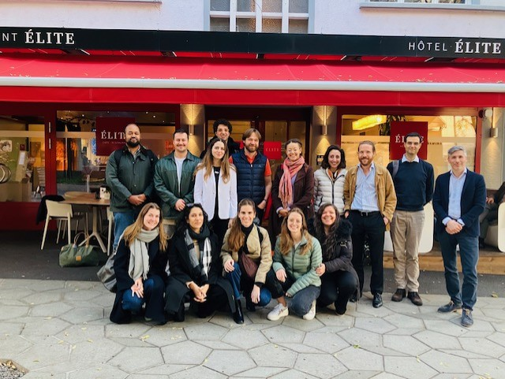

Today I had the pleasure of presenting part of my doctoral research at the CUSO séminarie annuel 2024 held in Sion under the theme «le futur du droit». In my presentation, I explored the future of international environmental law (IEL), examining why it is currently falling short and how it might be improved.

The central argument of my presentation was that IEL remains insufficiently effective because it has not yet adapted to the «new» worldview of the Earth as one single, complex, and interconnected system. Drawing on the concept of the Earth System Trajectories, as well as the Interactional Theory of International Law, I propose the introduction of an overarching goal for IEL. Such an overarching goal could serve as the foundation for a global shared understanding that the Earth is a complex and interconnected system, which we need to move and keep on the «Stabilized Earth» pathway.