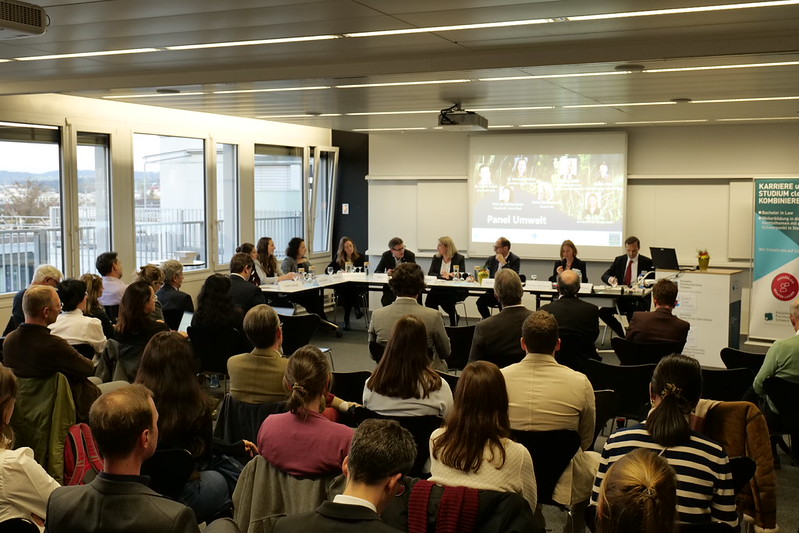

As part of the research and book project «Sustainable Development in Swiss Law», the 3rd Sustainability Symposium, titled «Sustainable Development: Testing the Law in Practice», took place today at the KLS Kalaidos Law School.

I had the honour of presenting my book chapter «Contaminated Site Law and Intergenerational Equity: are we on the right track?» and discussing our insights in a panel with fellow contributors to the volume and some distinguished practitioners. A report of the symposium, including a short summary of my presentation and the key takeaways of the day, is available [here](https://www.kalaidos-fh.ch/de-CH/Blog/Posts/2024/11/Nachhaltige-Entwicklung-Loest-Recht-die-Quadratur-des-Kreises).

**Update:** The [book](https://staempflirecht.ch/nachhaltige-entwicklung-im-schweizer-recht/ean-9783727228353) was published in October 2025. My chapter is now available open access on this website under «Publications».