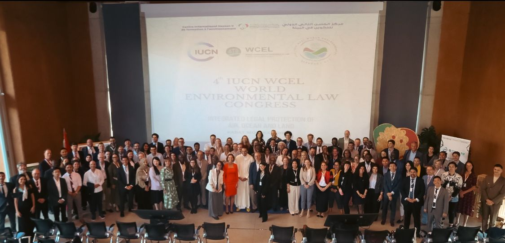
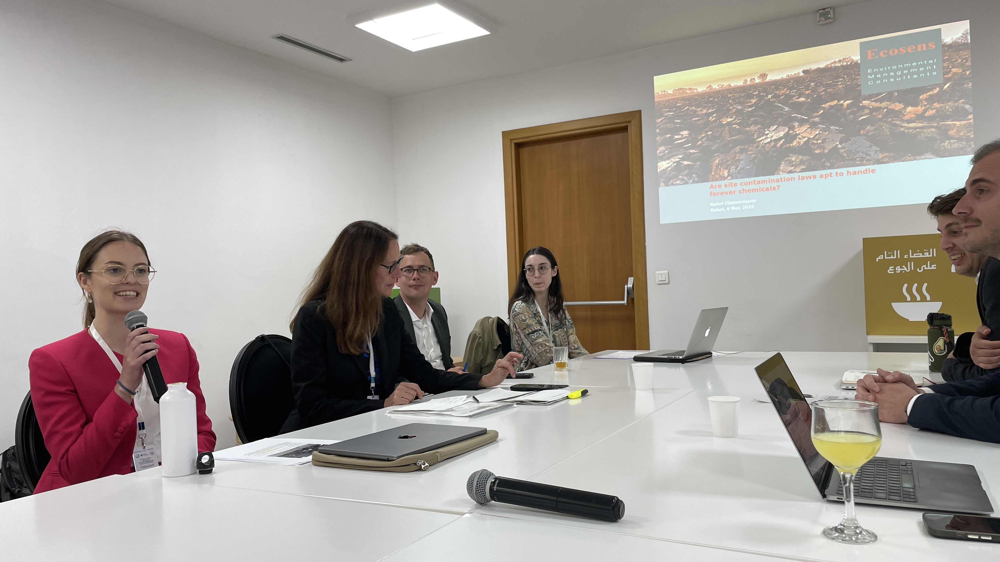

These days I am taking part at the [4th IUCN WCEL World Environmental Law Congress](https://iucn.org/events/iucn-event/4th-iucn-wcel-world-environmental-law-congress-5-7-may-2025) in beautiful Rabat. 

Today, our [IUCN WCEL Soil and Sustainable Agriculture Law Specialist Group](https://iucn.org/our-union/commissions/group/iucn-wcel-soil-and-sustainable-agriculture-law-specialist-group) organised a panel session on «integrated legal protection to secure the multifuncionality of soils». In my presentation, I discussed whether site contamination laws are apt to handle forever chemicals.

Using the example of Swiss site contamination law, I presented the enormous challenges that authorities face when dealing with sites contaminated by forever chemicals (PFAS). In the face of these challenges and in the interests of sustainable development as well as the associated precautionary principle and principle of intergenerational justice, I argued that a rapid and comprehensive ban on forever chemicals is urgently needed. 

