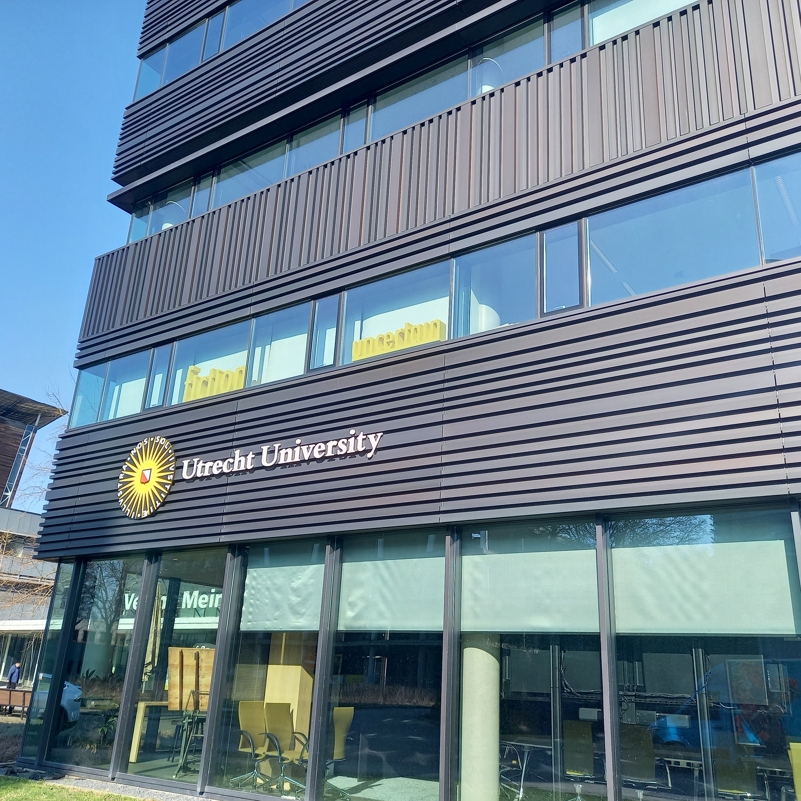
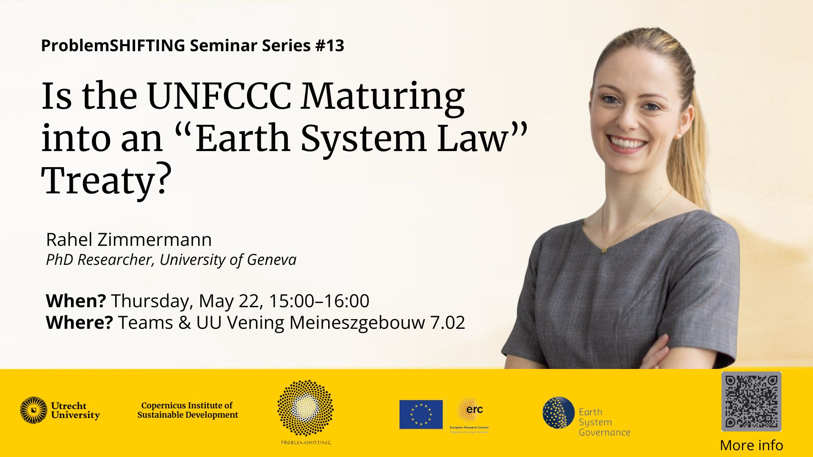
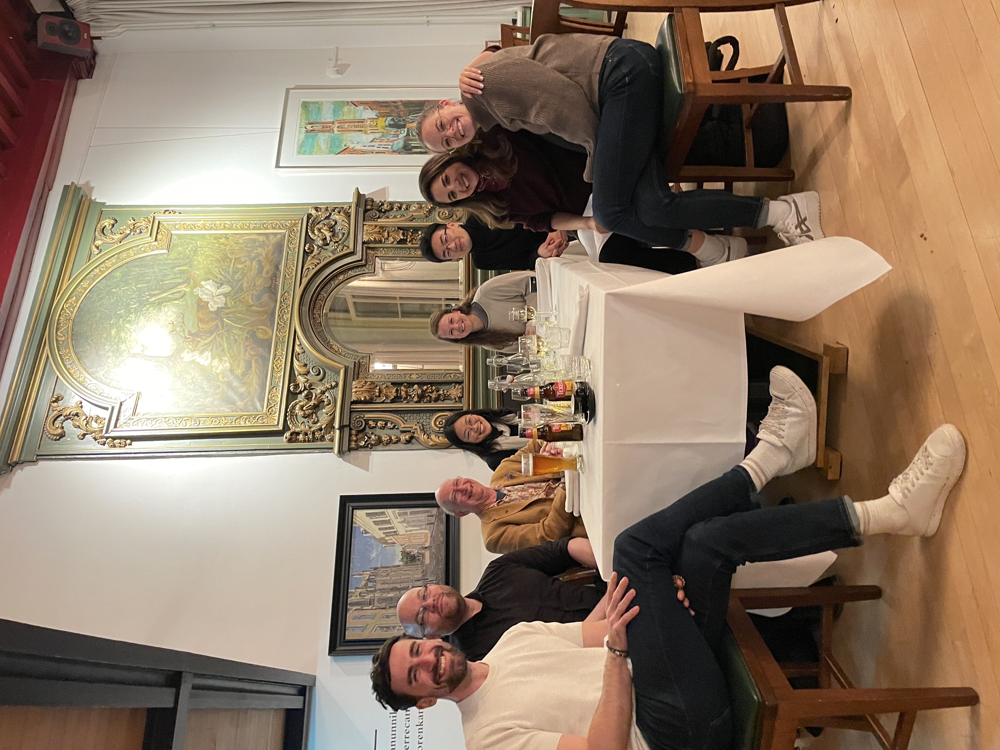
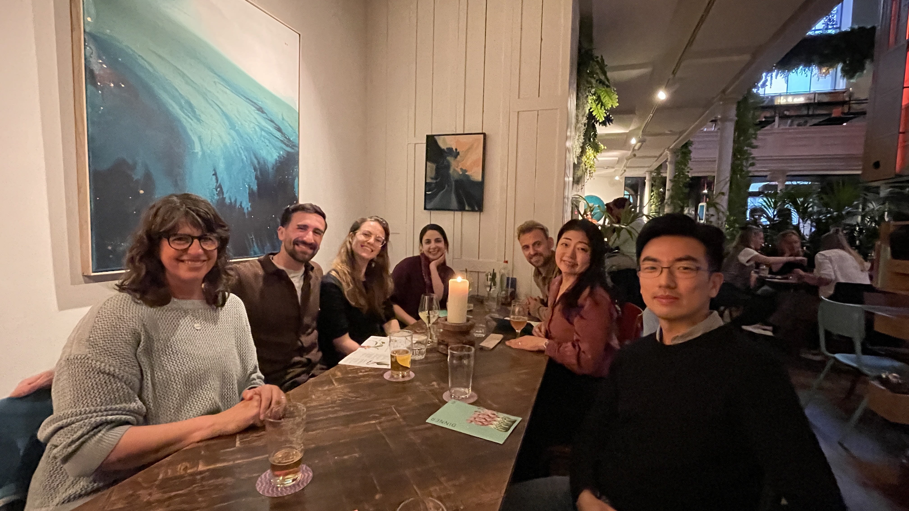

And with that conclude three incredibly enriching months as a visiting scholar at the [Copernicus Institute of Sustainable Development, Utrecht University](https://www.uu.nl/en/research/copernicus-institute-of-sustainable-development)! 

Besides gaining many new insights and connecting with brilliant scholars from all over the world, I was lucky enough to experience the most un-Dutch spring with almost nothing but sunshine, while enjoying the many Dutch specialties like Kings Day, cheese and stroopwafels. I will especially miss my daily bike ride to the office in the picturesque landscape between Zeist and Utrecht Science Park!🚲

Two special highlights during the last three months I want to pick out:
- My [PROBLEMSHIFTING](https://problemshifting.org/) Seminar on the paper that I am currently working on with Rakhyun E. Kim and Philipp Ratz trying to shed some light into the black hole called UNFCCC that has «swallowed» more and more topics and actors over the past 30+ years.
- My thesis presentation to Frank Biermann, Louis Kotzé, Rakhyun E. Kim, Işık Girgiç and Mara Wendebourg whose feedbacks expanded my own perspectives and gave me valuable directives for the final stretch of my doctoral research.

Thank you so much Rakhyun E. Kim for this amazing opportunity and to everybody who made this visit in the Netherlands so memorable with inspiring conversations, fun nights out and new friendships.

