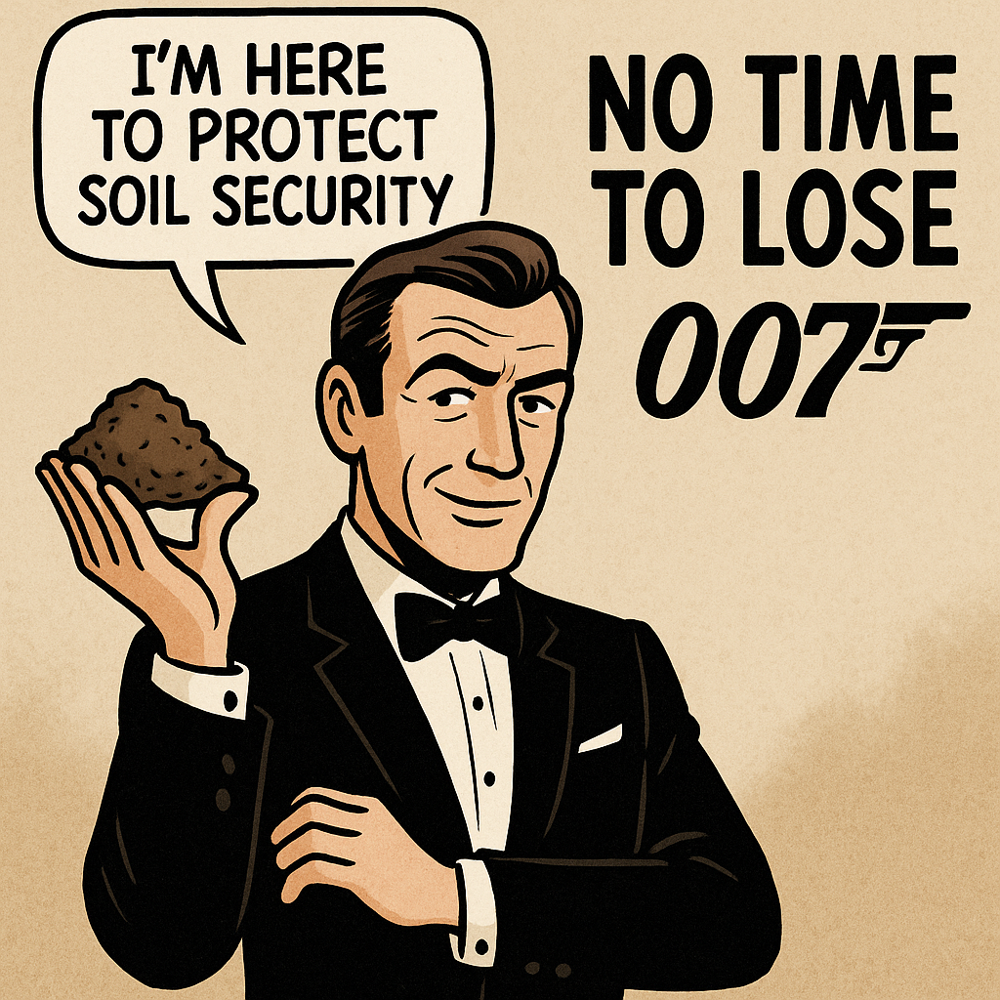

Today, at the IUCN World Conservation Congress 2025 in Abu Dhabi, the members of the IUCN adopted the [«Motion 007 on Soil Security Law»](https://iucncongress2025.org/assembly/motions/motion/007#motion_comments) that was initiated by our [IUCN WCEL Soil and Sustainable Agriculture Law Specialist Group](https://iucn.org/our-union/commissions/group/iucn-wcel-soil-and-sustainable-agriculture-law-specialist-group).

The motion requests the Director General to collaborate with WCEL as well as other relevant Commissions and interested members:

_a. to develop concepts and parameters for an international convention or a global legal instrument on soil security;_

_b. to evaluate and propose national or regional laws and policies to protect, restore and rehabilitate soil ecosystems, with a focus on sustainable agriculture; and_

_c. to encourage States and regions to adopt appropriate measures and legal frameworks, addressing threats to soil and promoting soil security across all sectors (including but not limited to agriculture, mining and infrastructure), with attention to vulnerable communities, and aligned with the United Nations Convention to Combat Desertification and Land Degradation Neutrality targets._

**Update:** On this bases, in November 2025, the IUCN WCEL Soil and Sustainable Agriculture Law Specialist Group has begun work on developing a new global legal instrument on soil security. Please feel free to get in touch if you have any questions or would like to learn more about this initiative.

