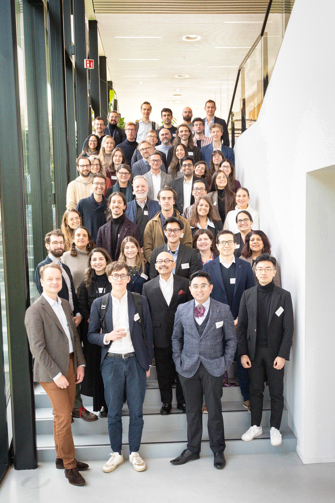
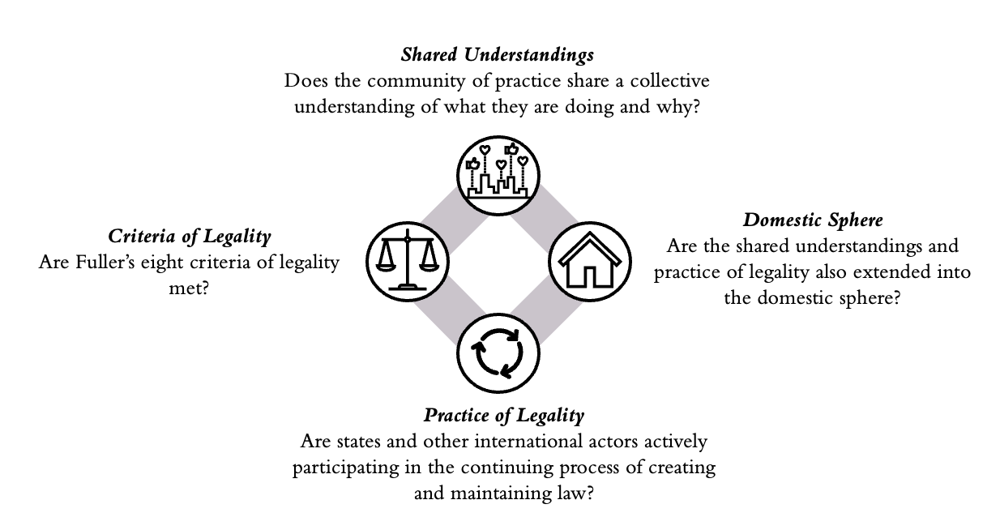

Today marked the opening of the symposium «Exploring New Frontiers in Earth System Law: From Theory to Practice» organised by the [Taskforce on Earth System Law](https://www.earthsystemgovernance.org/research/taskforce-on-earth-system-laws/) of the [Earth System Governance Project](https://www.earthsystemgovernance.org/what-we-do/), of which I am a [research fellow](https://www.earthsystemgovernance.org/person/rahel-zimmermann/).

I had the great honour of presenting parts of my doctoral research in one of the parallel sessions. In my presentation, entitled «Transitioning Earth System Law: From Exploratory Debate to In-Depth Reform Analysis», I argued that Earth System Law scholarship has already identified critical deficiencies within international environmental Law (IEL) and suggested numerous avenues for reform. Yet, all proposals so far have remained underdeveloped, often outlined only briefly and without systematic assessment of their comparative strengths, limitations and political feasibility. Therefore, to move the field forward, Earth System Law must now transition from exploratory idea generation to in-depth analysis capable of informing concrete legal and policy reform. My doctoral research seeks to provide a first contribution to this next phase and proposes that the Interactional Theory of International Law (cf. slide below) might serve as a valuable analytical lense. In the last part of my presentation, I drew on the example of the OECD/G20 Inclusive Framework on Base Erosion and Profit Shifting (BEPS), which is a very interactional legal framework in international tax law, that could inspire a legal reform proposal for IEL.

At the end of the day, I also had the opportunity to participate in the closing plenary, moderated by Işık Girgiç, where we reflected on the discussions and key insights that had emerged throughout the day.

A summary of the symposium, as well as of the author workshop held on the second day, is available [here](https://www.earthsystemgovernance.org/news/reflections-on-the-first-international-symposium-and-author-workshop-on-earth-system-law-12-13-november-2025/). The exchanges over the two days were exceptionally enriching, and I received highly valuable feedback on my doctoral research. I will keep you posted on the paper that will synthesise the outcomes of the author workshop and is expected to be published in 2026.
