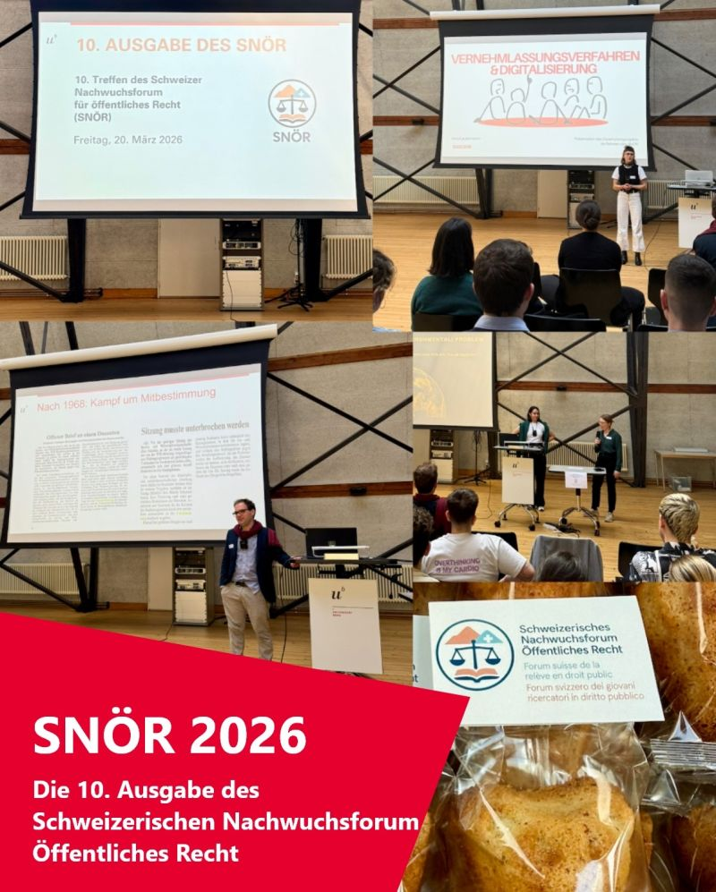
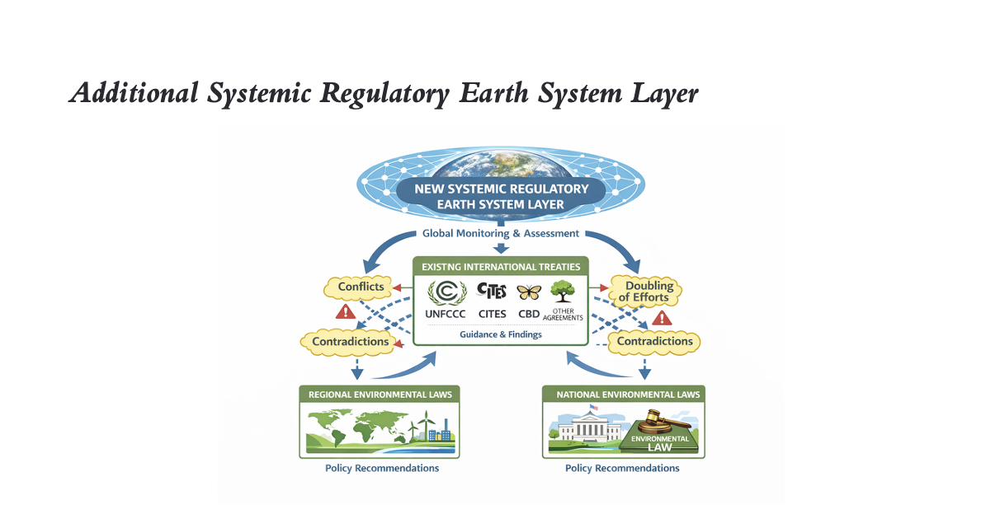
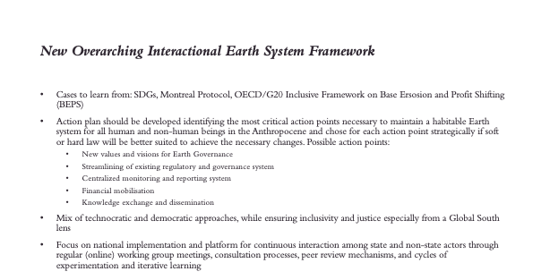
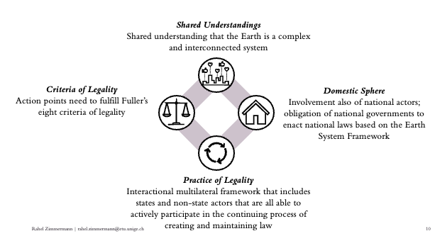

A fun and enriching day organised by the [Swiss Young Scholars’ Forum on Public Law (SNÖR)](https://iuspublicum.ch/) has come to a close. I had the opportunity to present my doctoral research, entitled «Moving International Environmental Law into a new Era: A Proposal to put Earth System Law into Practice».

In my presentation, I explained to my fellow doctoral researchers how my doctoral thesis draws on the Interactional Theory of International Law as well as insights from Earth System Science, Earth System Governance, and Earth System Law literature to undertake an in-depth diagnosis of international environmental law’s deficiencies. One of its main deficiencies is the absence of an actor or mechanism responsible for considering the broader, interconnected Earth system as a whole. To address this gap, I argue for the introduction of an additional systemic regulatory Earth system lawyer that keeps track of the overall state of the Earth system and gives inputs and guidance to the existing multilateral environmental agreements, as well as for regional and national environmental regulations in order to achieve a better net environmental outcome for the Earth system (the illustration above was created using AI). 

Learning from the Sustainable Development Goals (SDGs), the Montreal Protocol, and the OECD/G20 Inclusive Framework on Base Erosion and Profit Shifting (BEPS), my proposal for a new overarching interactional Earth System Framework consists of an action plan, that would chose for each action point strategically if soft or hard law is better suited to achieve the necessary changes, and would consist of a mix of technocratic and democratic approaches. 

Please feel free to get in touch if you have any questions or comments on this idea for a new reform proposal.